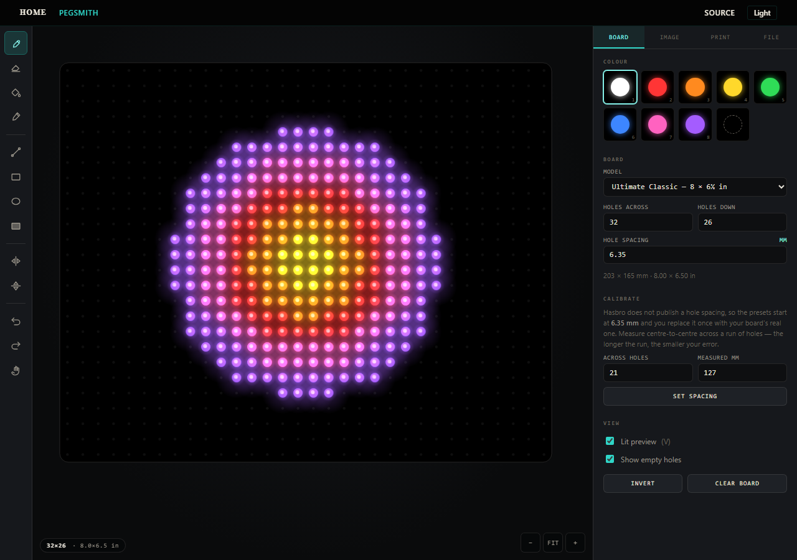

# Pegsmith

Design peg-light art on a grid, or convert a photograph to peg colours, then print a template at
true physical scale so the holes on paper land on the holes in the board. Pegsmith is a single-page
browser tool: a pixel editor with the eight peg colours plus "no peg", an image converter that
decides per hole which of those nine states is least wrong (redmean colour distance, Floyd-Steinberg
dithering, a dark cutoff judged before diffusion so a black background stays empty), and a print
path that lays the design out in millimetres.

Printing at scale is the part browsers get wrong, so it is the part the tool is built around. Each
sheet is an SVG sized in physical units with `@page { margin: 0 }`, large designs tile onto several
sheets pinned to one origin so the pitch carries across a trimmed join, and every sheet carries a
100 mm bar to measure with a ruler: if that bar is not 100 mm, the print dialog scaled the page and
the sheet is wrong. Nothing you load is uploaded anywhere; the design autosaves to `localStorage` and
can be saved as a `.pegsmith.json` file.



## Architecture

- `public/projects/pegsmith/index.php`: the page markup (tool rail, board, settings panel, print
  preview). The only server-side work is a handful of PHP `include`s for the shared page chrome.
- `public/projects/pegsmith/assets/js/pegsmith.js`: the whole tool. Vanilla JS, no build step, no
  dependencies: board model and run-length autosave, drawing tools, image conversion, calibration,
  tiling and the SVG sheet renderer.
- `public/projects/pegsmith/assets/css/pegsmith.css` and `pegsmith.light.css`: the editor's styles
  and its light-theme companion (scoped under `html[data-theme="light"]`).
- `public/includes/*`, `public/assets/site/*`: small stand-ins for the site chrome the page was
  built against (head, nav strip, theme toggle, `h()` escaper and the `--pw-*` design tokens the
  stylesheet reads). Replace them with your own site's fragments if you drop the page into an
  existing site.
- `tests/smoke.py`: lints the PHP, syntax-checks the script, serves the tree with PHP's built-in
  server and checks the page and its assets.

## Quickstart

You need PHP 8.1 or newer on PATH (`php -v`). Python 3 is needed only for the smoke test, and
Node.js only for its `node --check` step (skipped when Node is absent).

```
git clone https://github.com/printedwicked/pegsmith
cd pegsmith
php -S 127.0.0.1:8080 -t public
```

Open <http://127.0.0.1:8080/projects/pegsmith/>. Pick a board preset (or enter columns, rows and
pitch), draw with the pen (`B`), erase (`E`), fill, or drop a photo on the board to convert it. Then
"Print": check the 100 mm bar in the preview, turn off "fit to page" in the print dialog, and measure
the bar on the first sheet before you trust the rest.

Run the smoke test from the repository root:

```
python tests/smoke.py
```

## Calibration

Hole spacing is not published by the board makers, so the presets start at 6.35 mm (1/4 in).
Calibrate once: count a run of holes on the real board, measure centre to centre across that run,
and enter both; the tool divides by `n - 1` gaps. The reasoning behind that, the conversion choices
and the tiling rules are in [docs/guide.md](docs/guide.md).

## Configuration

There is nothing to configure on the server. The board presets, the peg palette and the paper sizes
are constants at the top of `assets/js/pegsmith.js`; edit them there. The page loads no external
resources.

## Screenshots

- `docs/screenshots/pegsmith.png`: the page served from this tree with `php -S`, rendered by
  headless Chrome in its opening state (the default preset and the design the script draws when
  nothing is saved yet). Nothing in it is user data.

## Tests

`python tests/smoke.py`: `php -l` on every PHP file, `node --check` on `pegsmith.js` (when Node is
installed), then it serves the tree with `php -S`, fetches the page, both stylesheets, the script and
the chrome files, checks each answers 200 with the expected content type, checks the root redirects to
the page, and checks that no PHP warning leaked into the page.

## Trademarks

Board and preset names are the trademarks of their manufacturers and are used here only to identify
compatible boards; Pegsmith is not affiliated with or endorsed by any of them.

## Licence

Licensed under the GNU AGPL-3.0. Copyright (c) 2026 Printed Wicked.
